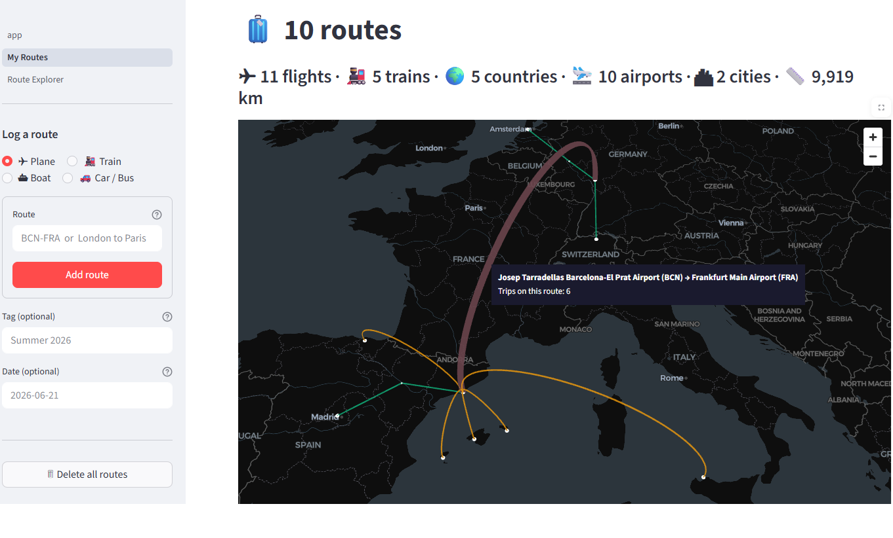
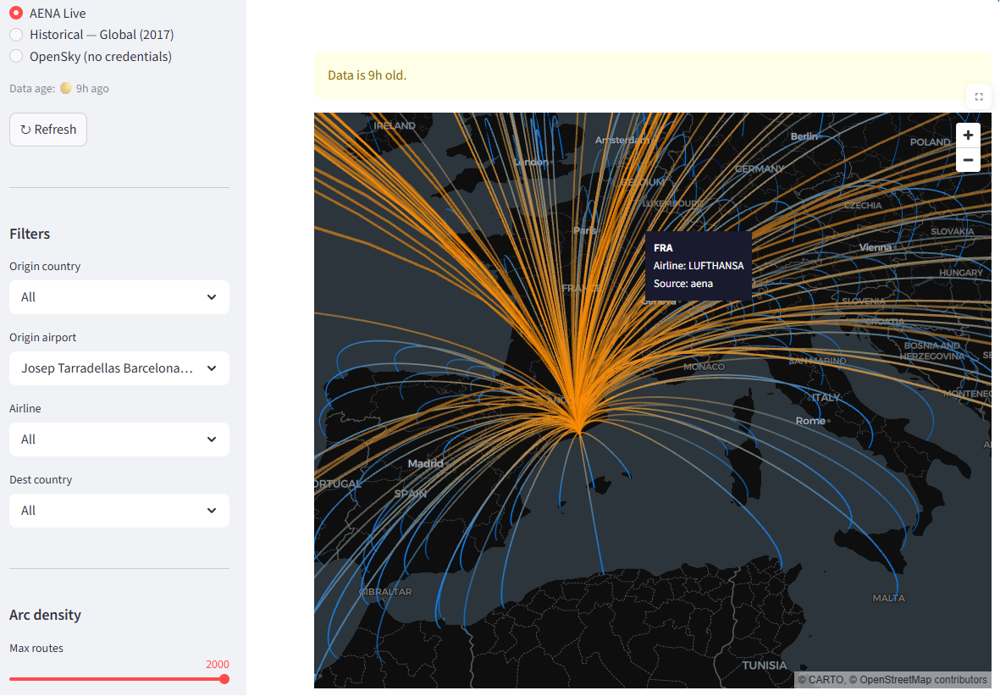

# ✈ PyFly

**Live app: [pyfly-routes.streamlit.app](https://pyfly-routes.streamlit.app/)**

Map your personal travel history and explore the world's flight network.

PyFly has four pages:
- **My Routes** — log every route you've taken (flights, trains, boats, cars). Arcs thicken by how many times you've done the route, coloured by mode or region. Share via URL or export as JSON. Convert any selection into a trip.
- **My Trips** — group routes into named trips with markdown notes. Collapsible cards, each with its own map and region colouring. Reorder, edit, delete, or convert a trip back into individual routes. Unlocked once you save your first trip.
- **Route Explorer** — browse scheduled and historical flight routes as great circle arcs. Explore the live AENA Spanish network, the live ANA Portuguese network (incl. Madeira and the Azores), a 2017 global baseline covering 3,400+ airports, or real-time OpenSky records.
- **Airport Explorer** — find airports worldwide on an interactive map. Filter by type and country, look up IATA codes and coordinates.

---

## What it looks like

### My Routes



Log routes by typing `BCN-LHR`, `Paris to London`, or `Frankfurt - Madrid`. Flights render as lifted arcs, ground transport as flat lines. Arcs thicken when you've repeated a route. Stats bar shows total flights, countries, airports, and distance.

### Route Explorer



Each arc represents a direct route. Orange end = origin, blue end = destination.
Hover any arc for the destination code, airline name, and data source.
Filter by origin airport, airline, or destination country. Adjust arc density with
the slider (default 500 — raise it or pick a single airport to see everything).

---

## Data sources

| Source | What | Freshness | Auth |
|---|---|---|---|
| **AENA Live** | Current scheduled routes scraped from aena.es | Manual scrape (CLI or GitHub Actions) | None |
| **ANA Live** | Current routes scraped from the 9 ANA Aeroportos de Portugal airport sites | Manual scrape (CLI or GitHub Actions) | None |
| **Avinor Live** | Scheduled + charter routes from the avinor.no direct-routes pages (8 of Avinor's 43 airports publish one; no airlines) | Manual scrape (CLI or GitHub Actions) | None |
| **Avinor Feed** | Every route flown from all 43 Avinor airports in the next 14 days, with airlines, from Avinor's open flight data feed | Manual scrape (CLI or GitHub Actions) | None |
| **Swedavia Live** | Scheduled + charter destinations with airlines for Swedavia's 10 airports, from swedavia.com's destination lists | Manual scrape (CLI or GitHub Actions) | None |
| **Isavia Domestic** | Iceland's domestic network (plus Akureyri–Greenland) with airlines, from innanlandsflugvellir.is; excludes Keflavík | Manual scrape (CLI or GitHub Actions) | None |
| **ANAC VRA (Brazil)** | Every scheduled passenger route flown ≥4×/month to, from or within Brazil (Brazilian and foreign airlines), from ANAC's Voo Regular Ativo open data | Monthly data, ~1–2-month lag; manual download | None |
| **BTS T-100 (USA)** | Every scheduled passenger route flown ≥4×/month to, from or within the US, by operating carrier, from the US DOT's T-100 Segment table | Monthly data, ~3-month lag; manual download | None |
| **Historical (2017)** | OpenFlights open dataset, pre-COVID baseline | Static | None |
| **OpenSky** | Actual flights flown in the last 7 days | On demand, 24h cache | Free account |

---

## Quick start

**Requirements:** Python 3.12+, [uv](https://docs.astral.sh/uv/)

```bash
# Clone and install
git clone <repo-url>
cd PyFly
uv sync --extra scraper      # includes Playwright for the AENA and ANA scrapers
uv run playwright install chromium

# Populate the database (uses committed parquet snapshots — no scrape needed)
uv run python -m pyfly --source openflights --scope aena

# Or run the live AENA scraper (~4 min, scrapes all 43 airports)
uv run python -m pyfly --source aena --scope aena

# Launch the app
uv run streamlit run pyfly/app.py
```

Open [http://localhost:8501](http://localhost:8501).

---

## Project structure

```
PyFly/
├── pyfly/
│   ├── app.py                  ← Streamlit entry point + navigation
│   ├── pages/
│   │   ├── 1_My_Routes.py      ← Personal travel map + Convert to Trip
│   │   ├── 2_Route_Explorer.py ← Global route explorer (AENA / ANA / OpenFlights / OpenSky)
│   │   ├── 3_Airport_Explorer.py ← Airport lookup map
│   │   └── 5_My_Trips.py       ← Trip cards + Convert to Routes
│   ├── sources/
│   │   ├── base.py             ← FlightSource ABC + Scope enum + schema
│   │   ├── aena.py             ← Live Playwright scraper (CLI only)
│   │   ├── ana.py              ← Live Playwright scraper for Portugal (CLI only)
│   │   ├── avinor.py           ← avinor.no direct-routes pages, Norway (CLI only)
│   │   ├── avinor_feed.py      ← Avinor open XML flight data feed, Norway (CLI only)
│   │   ├── swedavia.py         ← swedavia.com destination lists, Sweden (CLI only)
│   │   ├── isavia.py           ← innanlandsflugvellir.is destination cards, Iceland (CLI only)
│   │   ├── bts.py              ← US DOT BTS T-100 Segment, monthly (CLI only)
│   │   ├── anac.py             ← Brazil ANAC Voo Regular Ativo, monthly (CLI only)
│   │   ├── openflights.py      ← Historical 2017 source
│   │   └── opensky.py          ← OpenSky REST API + DuckDB cache
│   ├── enrich.py               ← Coordinate + airline name enrichment
│   ├── ingest.py               ← Fetch → enrich → write pipeline
│   ├── db.py                   ← DuckDB read/write + OpenSky cache
│   ├── history.py              ← Scrape archive: compare snapshots
│   └── exceptions.py           ← ScraperError, AuthError
├── config/
│   ├── airport_urls.json       ← All 43 AENA airports + their page URLs
│   ├── ana_destinations.json   ← ANA destination names → IATA (hand-reviewed)
│   └── swedavia_destinations.json ← Swedavia names → IATA, per airline for multi-airport cities
├── data/
│   ├── airports.csv            ← OurAirports (coordinates + IATA/ICAO mapping)
│   ├── routes.dat              ← OpenFlights routes (~2017)
│   ├── airlines.dat            ← OpenFlights airline names
│   ├── routes_aena.parquet     ← Committed live snapshot (updated by each scrape)
│   ├── routes_ana.parquet      ← Committed live snapshot (updated by each scrape)
│   ├── history/<source>/<date>.parquet ← Every AENA/ANA scrape, kept for change tracking
│   └── routes_openflights.parquet
├── tests/
│   ├── test_aena.py
│   ├── test_ana.py
│   ├── test_avinor.py
│   ├── test_swedavia.py
│   ├── test_isavia.py
│   ├── test_bts.py
│   ├── test_anac.py
│   ├── test_history.py
│   ├── test_openflights.py
│   └── test_opensky.py
├── archive/                    ← Original 2022 scripts (reference only)
└── .github/workflows/
    └── scrape.yml              ← Manually triggered AENA + ANA scrape + parquet commit
```

---

## CLI reference

```bash
# AENA live scrape (requires --extra scraper + Playwright)
uv run python -m pyfly --source aena --scope aena

# ANA (Portugal) live scrape — 9 airports; Beja has no scheduled flights.
# Unknown destination names are logged and skipped: add them to config/ana_destinations.json
uv run python -m pyfly --source ana --scope portugal

# Avinor (Norway) — website route lists (8 airports, no airlines) and the open feed
# (all 43 airports, next 14 days, with airlines). Plain HTTP, no Playwright needed.
uv run python -m pyfly --source avinor --scope norway
uv run python -m pyfly --source avinor_feed --scope norway

# Swedavia (Sweden) — 10 airports, plain HTTP. Unknown destination names are logged and
# skipped: add them to config/swedavia_destinations.json
uv run python -m pyfly --source swedavia --scope sweden

# Isavia Domestic (Iceland) — 12 domestic airports, plain HTTP (Keflavík not included)
uv run python -m pyfly --source isavia --scope iceland

# BTS T-100 (USA) — latest published month; --backfill N also archives the N-1 months before it
uv run python -m pyfly --source bts --scope usa
uv run python -m pyfly --source bts --scope usa --backfill 12

# ANAC VRA (Brazil) — latest published month; --backfill 12 also archives the previous 11
uv run python -m pyfly --source anac --scope brazil --backfill 12

# Historical data (no scraping, reads local files)
uv run python -m pyfly --source openflights --scope aena
uv run python -m pyfly --source openflights --scope european
uv run python -m pyfly --source openflights --scope global_top_100

# OpenSky (requires .env credentials)
uv run python -m pyfly --source opensky --scope aena

# Run tests
uv run pytest tests/ -v
```

---

## OpenSky setup (optional)

Register a free account at [opensky-network.org](https://opensky-network.org), then:

```bash
cp .env.example .env
# Edit .env and add your credentials
OPENSKY_USERNAME=your_username
OPENSKY_PASSWORD=your_password
```

Free tier: 400 API credits/day. Each airport query costs 1 credit.
Results are cached in DuckDB for 24 hours per airport.

---

## Deploying to Streamlit Cloud

1. Push the repo to GitHub — `data/pyfly.ddb` and `.env` are gitignored
2. Connect at [share.streamlit.io](https://share.streamlit.io), set main file: `pyfly/app.py`
3. Add OpenSky credentials as Streamlit Secrets (optional)

The app reads from the committed parquet snapshots on cold start — no scraping
needed in the cloud environment, and no Playwright dependency required.

Scrapes are triggered manually — either locally with the CLI (then commit the updated
parquets), or from the GitHub Actions tab ("Run workflow" on `.github/workflows/scrape.yml`),
which runs the AENA and ANA scrapers and commits the updated parquets back to the repo.
Streamlit Cloud picks up the new commit automatically.

Each scrape records its UTC time in the snapshot, which Route Explorer shows as "scraped on".
AENA and ANA scrapes are also archived to `data/history/<source>/<YYYY-MM-DD>.parquet`
(a same-day rescrape replaces that day's file), and Route Explorer lists the routes added
and dropped since the previous scrape. Query the full archive with DuckDB:

```sql
SELECT * FROM read_parquet('data/history/aena/*.parquet');
```

---

## Adding a new source

1. Create `pyfly/sources/newsource.py` implementing `FlightSource`
2. Add one line to `SOURCES` in `ingest.py`
3. Add the source to the toggle in `pages/1_Route_Map.py`
4. Add `tests/test_newsource.py` following the existing pattern

Nothing else changes.

---

## Tech stack

| | |
|---|---|
| Scraping | Playwright (headless Chromium) + BeautifulSoup4 |
| Data processing | Polars |
| Storage | DuckDB (local) + Parquet (committed snapshots) |
| Visualisation | pydeck ArcLayer + CartoDB basemap |
| App | Streamlit |
| Package management | uv |
| CI/CD | GitHub Actions |

---

*Data sources: [aena.es](https://www.aena.es) · [ANA Aeroportos de Portugal](https://www.ana.pt) · [Avinor](https://www.avinor.no) · [Swedavia](https://www.swedavia.com) · [Isavia](https://www.innanlandsflugvellir.is/en) · [BTS TranStats](https://www.transtats.bts.gov) · [ANAC](https://sistemas.anac.gov.br/dadosabertos/) · [OpenFlights](https://openflights.org/data.html) · [OpenSky Network](https://opensky-network.org) · [OurAirports](https://ourairports.com/data/)*

---

## Licences and attribution

| Source | Licence | Notes |
|---|---|---|
| [OpenFlights](https://openflights.org/data.html) routes & airlines | [ODbL 1.0](https://opendatacommons.org/licenses/odbl/) | Attribution required; derivative databases must be shared under the same licence |
| [OurAirports](https://ourairports.com/data/) airport data | Public domain | No restrictions |
| [Natural Earth](https://www.naturalearthdata.com/) region boundaries | Public domain | No restrictions |
| [OpenStreetMap](https://www.openstreetmap.org/copyright) (road routing via OSRM, geocoding via Nominatim) | [ODbL 1.0](https://opendatacommons.org/licenses/odbl/) | Must display "© OpenStreetMap contributors" |
| [CARTO](https://carto.com/legal/) Dark Matter basemap tiles | [CC BY 3.0](https://creativecommons.org/licenses/by/3.0/) | Must display "© CARTO" alongside OpenStreetMap attribution |
| [OpenSky Network](https://opensky-network.org/about/terms-of-use) | Non-commercial research | Free-tier API use only; commercial use requires a separate agreement |
| [AENA](https://www.aena.es) route schedules | Scraped from public pages | Factual timetable data; not redistributed — only aggregated route pairs are stored |
| [ANA Aeroportos de Portugal](https://www.ana.pt) airline & destination listings | Scraped from public pages | Same as AENA — only aggregated route pairs and airline names are stored |
| [Avinor](https://www.avinor.no) direct-routes pages | Scraped from public pages | Same as AENA — only route pairs are stored |
| [Swedavia](https://www.swedavia.com) destination lists | Scraped from public pages | Same as AENA — only route pairs and airline names are stored |
| [Isavia Domestic Airports](https://www.innanlandsflugvellir.is/en) destination pages | Scraped from public pages | Same as AENA — only route pairs and airline names are stored |
| [BTS T-100 Segment](https://www.transtats.bts.gov/Fields.asp?gnoyr_VQ=FMG) (US DOT) | US government work, public domain | Downloaded from TranStats; only route pairs and carriers are stored |
| [ANAC Voo Regular Ativo](https://sistemas.anac.gov.br/dadosabertos/) (Brazil) | Brazilian government open data | Monthly CSVs from ANAC's open data directory; only route pairs and airlines are stored |
| [Avinor flight data](https://partner.avinor.no/en/services/flight-data/) XML feed | Offered by Avinor for reuse in other services | Fetched on manual scrapes only and cached as snapshots, as Avinor asks; only route pairs and airline names are stored |

This project is intended for **personal and educational use**. The committed AENA and ANA parquet snapshots contain only origin–destination pairs derived from publicly accessible schedule pages, not raw page content.

### Copyright

© 2025 Barren-d ([github.com/Barren-d](https://github.com/Barren-d)). Source code is publicly available for personal and educational use. Commercial use requires explicit written permission — see [LICENSE](LICENSE).
